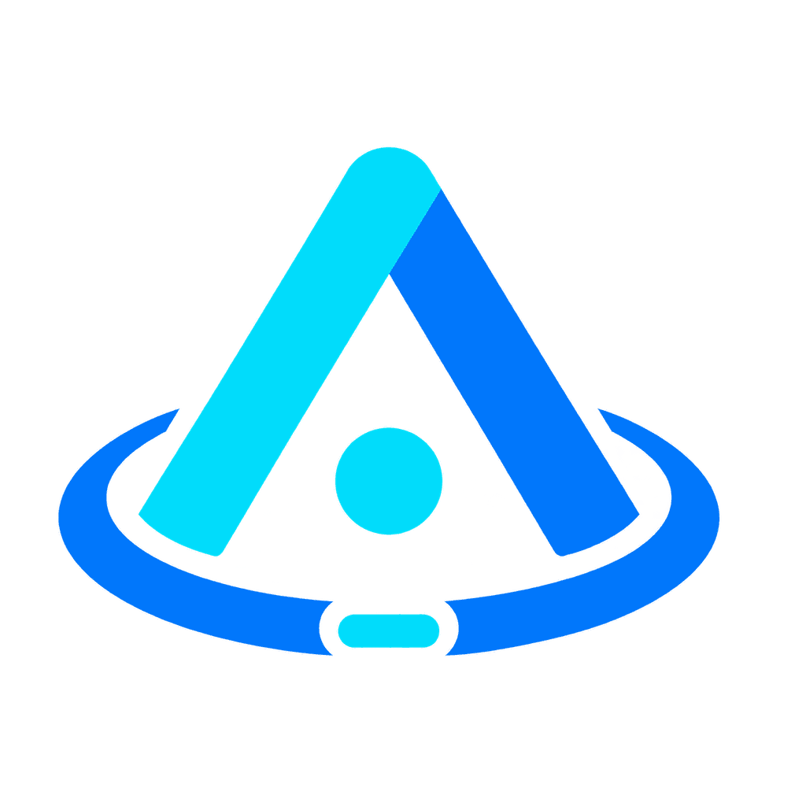
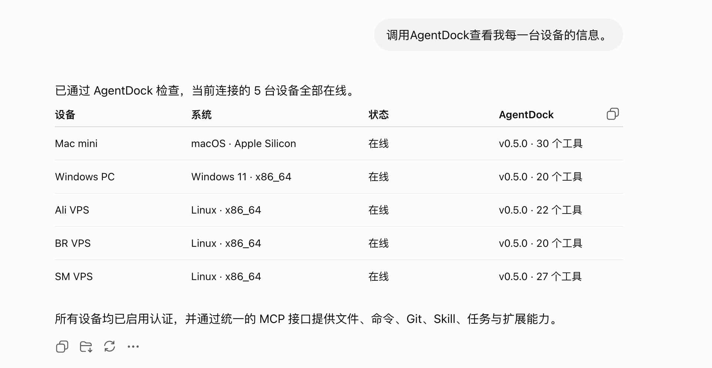

<div align="center">

English | [简体中文](./README.zh-CN.md)



# AgentDock MCP

**Give AI agents secure, controlled access to every machine you operate.**

Open ChatGPT in your browser and manage multiple computers and servers from one conversation. Write code, change configuration, run commands, and deploy in the real environment where the work belongs—without consuming a dedicated Codex coding quota.

<a href="https://trendshift.io/repositories/136526?utm_source=trendshift-badge&amp;utm_medium=badge&amp;utm_campaign=badge-trendshift-136526" target="_blank" rel="noopener noreferrer"></a>

[Documentation](https://docs.nexusdock.co/agentdock/) · [Download](https://www.nexusdock.co/download/) · [Code signing policy](./docs/code-signing-policy.md) · [Community](https://qun.qq.com/universal-share/share?ac=1&authKey=Rp86bSzI7vqm87KoYlKawgsPZ440Ubhyezw6Qkgcn3JISwX3zXxsXkbS5598RrY5&busi_data=eyJncm91cENvZGUiOiIxMDgxMzM3MDE5IiwidG9rZW4iOiJ0Mlg1bUU1ZWtuZzF3SHJDT3pSaGsrOURIMlNYaXBlYllOUjNLZ1BUb1hzM2lJSTZjeVNldzU0ajl0SjRVZkx2IiwidWluIjoiMzIwMjA4ODAzMiJ9&data=W28mWvuqaLf_Fwnf0CgAJXuDs6l3A78V7AoWZnizPboCpKoQMzHzZ-UlluYo47U3tmIBHK2xIgWEVEJbTiGsPQ&svctype=4&tempid=h5_group_info)

[](https://github.com/uvwt/agentdock/actions/workflows/ci.yml)
[](https://github.com/uvwt/agentdock/releases)
[](https://hub.docker.com/r/agentdockio/agentdock)
[](https://github.com/uvwt/agentdock/pkgs/container/agentdock)
[](./LICENSE)

</div>

<p align="center">
  
</p>

## What is AgentDock?

AgentDock connects AI assistants to your computers and servers so they can carry out tasks on your devices.

It provides unified, secure, and controlled file, command, Git, Skill, MCP, browser automation, and task execution across local computers, remote servers, and containers. Connect multiple AgentDock instances to coordinate work across devices and finish multi-machine workflows in a single conversation.

```text
              ChatGPT / Claude / Codex
                        │
                        │ MCP (multiple instances supported)
          ┌─────────────┼─────────────┐
          ▼             ▼             ▼
   ┌───────────┐ ┌───────────┐ ┌───────────┐
   │ AgentDock │ │ AgentDock │ │ AgentDock │
   │ Local Mac │ │ LAN Host  │ │ Cloud VPS │
   └─────┬─────┘ └─────┬─────┘ └─────┬─────┘
         │             │             │
         ▼             ▼             ▼
   Files · Shell · Git  Tunnels       Proxy · Deploy
```

## What can AgentDock do?

- Manage multiple computers and servers directly from ChatGPT without repeatedly switching SSH sessions
- Write code, modify projects, run tests, and operate Git in the real local or remote environment without depending on a dedicated coding-agent quota
- Manage VPS hosts, Docker services, reverse proxies, and deployment configuration
- Operate authenticated web pages and macOS desktop applications
- Extend capabilities through Skills and dynamic MCP servers
- Persist long-running task state and continue after an interruption
- And more

## Quick start

Regular users can install AgentDock from the official package for their operating system. You do not need the source code or Go.

See [Install AgentDock](https://uvwt.github.io/agentdock-docs/docs/getting-started/install) for the complete instructions.

| Platform | Documentation |
| --- | --- |
| Docker | [Docker installation](https://uvwt.github.io/agentdock-docs/docs/getting-started/docker) |
| Linux | [Automated Linux installation](https://uvwt.github.io/agentdock-docs/docs/getting-started/linux) |
| Linux / VPS | [Manual systemd deployment](https://uvwt.github.io/agentdock-docs/docs/getting-started/vps) |
| macOS | [macOS installation](https://uvwt.github.io/agentdock-docs/docs/getting-started/macos) |
| Windows | [Graphical Windows installer](https://uvwt.github.io/agentdock-docs/docs/getting-started/windows) |

### Connect your device

On macOS and Windows, open **Connections** in the control panel to pair your device with the official remote service. Get a pairing code from the [NexusDock devices page](https://mcp.nexusdock.co/workspace/devices), enter it, and click **Connect**. You can also choose a self-hosted service.

For local MCP or direct public access, open **Settings → Advanced connection**, or use **Advanced connection settings** on the Connections page. This is where you find the local MCP address, access credentials, and Cloudflare settings for a temporary public address or fixed domain. For Linux and Docker, follow the installation documentation to configure the connection.

## Direct MCP connection

When connecting directly, add the MCP address and Bearer Token or OAuth sign-in details to your client's MCP, Tools, or Connectors settings. Public access must keep authentication enabled. Do not include credentials in screenshots, issues, or public conversations.

AgentDock uses MCP Streamable HTTP. The exact client syntax varies; a typical local configuration looks like this:

```json
{
  "mcpServers": {
    "agentdock": {
      "url": "http://127.0.0.1:8765/mcp",
      "headers": {
        "Authorization": "Bearer <AGENTDOCK_AUTH_TOKEN>"
      }
    }
  }
}
```

## Core capabilities

- **Files and commands:** Read and write files, search code, and run commands on your devices.
- **Multi-device management:** Connect local computers, servers, and containers to complete work across devices. Pair with NexusDock for a shared entrypoint and project memory.
- **Browser and desktop automation:** Operate web pages, reuse login sessions, take screenshots, and control macOS desktop applications.
- **Extensions:** Add tools through Skills and MCP servers. Find official and community Skills in [agentdock-skills](https://github.com/uvwt/agentdock-skills).
- **Coding assistants:** Connect Codex, Claude, and other supported coding assistants to develop projects on your devices.
- **Task recovery:** Save progress and checkpoints so long-running work can continue after an interruption.

See the [documentation](https://docs.nexusdock.co/agentdock/) for configuration and usage details.

## Runtime directories

| Path | Purpose |
| --- | --- |
| `~/AgentDock` | Default working directory for relative file operations |
| `~/.agentdock` | AgentDock state, configuration, sessions, and extension data |

## Thanks to our sponsors

| <div align="center"><strong>🏆&nbsp;Sponsors&nbsp;🏆</strong></div> | <div align="center"><strong>Description</strong></div> |
| :------------- | :------ |
| <a href="https://www.swiftproxy.net/?ref=agentdock"></a> | <br>[**Swiftproxy**](https://www.swiftproxy.net/?ref=agentdock)<br>Offers rotating and static residential proxies with 90M+ IPs across 220+ locations. Supporting HTTP(S), SOCKS5, and sticky sessions, it provides flexible proxy solutions for AI agents, browser automation, and web data collection. Plans start at $0.7/GB. Use code <code>PROXY90</code> for 10% off. [Learn more →](https://www.swiftproxy.net/?ref=agentdock) |
| <a href="https://www.ipwo.net/?ref=githubagentdock"></a> | <br>[**IPWO**](https://www.ipwo.net/?ref=githubagentdock)<br>Provides flexible network connectivity for AI agents and automated workflows. IPWO residential proxies cover 195+ countries and regions, offering rotating, static, and unlimited-bandwidth proxies with HTTP(S)/SOCKS5 support. Suitable for cross-region access testing, web automation, and compliant data collection, helping developers explore more use cases. Use code <code>0200</code> for 10% off. [Learn more →](https://www.ipwo.net/?ref=githubagentdock) |

Want to support the project or showcase your brand? [Contact the maintainer](mailto:t80980@gmail.com).

## Support the project

<p>If <b>AgentDock</b> helps you, please consider giving it a <b>Star</b> ⭐. Thank you for your support</p>

| WeChat | Alipay | Buy Me a Coffee |
| :---: | :---: | :---: |
| <a href="./docs/assets/donation/wechat-qr.png"></a> | <a href="./docs/assets/donation/alipay-qr.png"></a> | <a href="https://buymeacoffee.com/uvwt"></a> |

## Star History

[](https://star-history.com/#uvwt/agentdock&Date)

## Related links

- [Documentation](https://docs.nexusdock.co/agentdock/)
- [GitHub Releases](https://github.com/uvwt/agentdock/releases)
- [Linux Do](https://linux.do/)

## License

Apache License 2.0. See [LICENSE](./LICENSE).

## Community

[Join the QQ group (1081337019)](https://qun.qq.com/universal-share/share?ac=1&authKey=Rp86bSzI7vqm87KoYlKawgsPZ440Ubhyezw6Qkgcn3JISwX3zXxsXkbS5598RrY5&busi_data=eyJncm91cENvZGUiOiIxMDgxMzM3MDE5IiwidG9rZW4iOiJ0Mlg1bUU1ZWtuZzF3SHJDT3pSaGsrOURIMlNYaXBlYllOUjNLZ1BUb1hzM2lJSTZjeVNldzU0ajl0SjRVZkx2IiwidWluIjoiMzIwMjA4ODAzMiJ9&data=W28mWvuqaLf_Fwnf0CgAJXuDs6l3A78V7AoWZnizPboCpKoQMzHzZ-UlluYo47U3tmIBHK2xIgWEVEJbTiGsPQ&svctype=4&tempid=h5_group_info)
